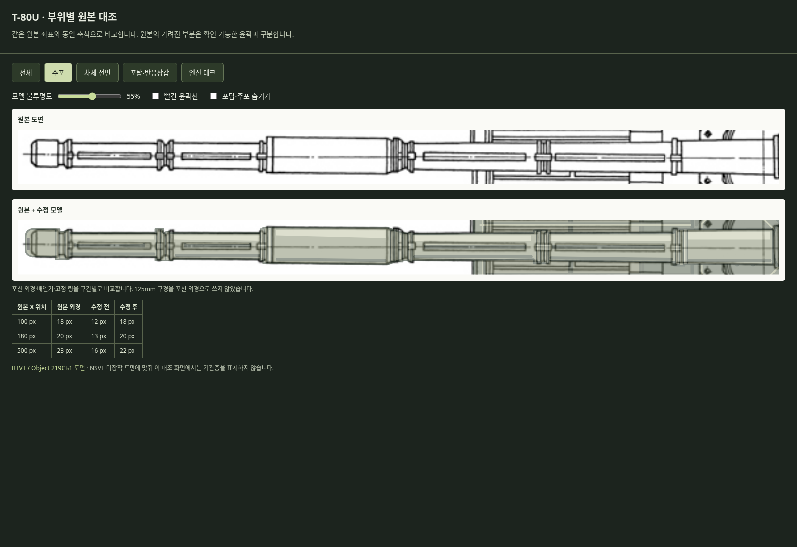
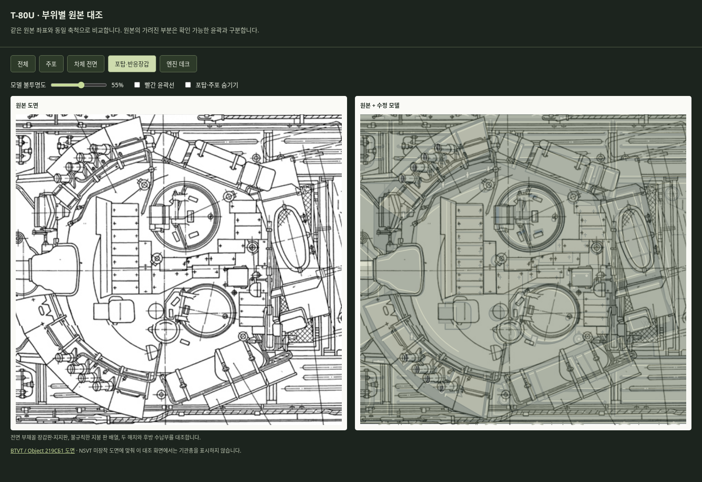
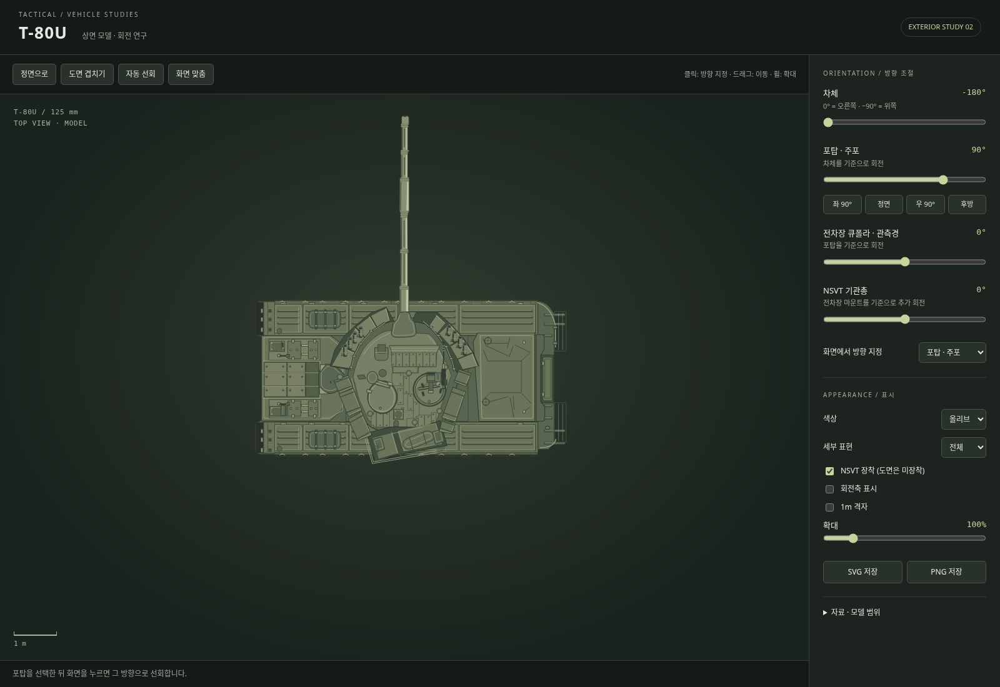

# T-80U 외형 수정 2판 — 2026-11-14

첫 버전 `54f5e3b`는 실제 도면 겹치기를 했지만 검토가 충분하지 않았다. 회전 행렬·저장·모바일 검사가 통과한 것을 외형 완성도까지 확인한 것처럼 보고했다. 주포가 얇고, 차체 전면 반응장갑·포탑 장갑판·엔진 데크를 임의 반복 도형으로 단순화한 오류를 수정했다.

## 다시 그린 부분

- **주포**: 포구·열차폐관·배연기·고정 링을 실제 외경으로 다시 추적했다. 원본 x=100 위치의 18px 외경을 이전 모델은 12px로, x=180의 20px를 13px로 그렸다. 수정본은 각각 18px·20px다. 125mm 구경과 외경을 혼동하지 않는다.
- **차체 전면 반응장갑**: 임의 3×2 반복 사각판을 제거하고 양쪽 큰 덮개, 중앙 판열과 고정구 배치를 다시 그렸다. 차체 레이어가 주포 아래까지 이어진다. 원본에서 주포가 가리는 좁은 부분의 판 이음선은 주변 배열에서 이어 그린 추정이며 직접 관측한 것으로 주장하지 않는다.
- **포탑 반응장갑**: 전면 부채꼴 장갑판의 실제 외곽·각도와 내부 고정 레일을 다시 추적했다. 지붕의 판은 3×2 반복 배열 대신 해치 주변까지 이어지는 불규칙한 배열로 바꿨다. 지지판과 장갑판은 별도 경로다.
- **차체·포탑 세부**: 잘못된 쌍둥이 타원형 엔진 덮개를 원본의 큰 압형 덮개로 바꾸고, 펜더 리브·앞쪽 적재함·후부 브래킷을 고쳤다. 포탑 후방의 과도하게 긴 원통, 해치 내부와 관측장비 위치도 다시 추적했다.
- **대조 구성**: 원본 상면도에는 NSVT가 없어 대조 화면에서 기관총과 추가 마운트를 감춘다. 회전 미리보기에서 장착을 선택할 수 있다.

## 확인 자료

ZIP에 `T80U_TopView.html`과 `T80U_ReferenceCheck.html`이 함께 들어 있다. 후자는 주포/차체 전면/포탑/엔진 데크를 원본과 나란히 보여주고, 같은 좌표로 겹치기·빨간 윤곽선·불투명도·포탑 숨기기를 지원한다.

`verify_t80u_reference.cjs`는 원본 이미지에서 독립적으로 읽은 주포 10개 단면의 상·하 경계와 폭을 렌더링과 비교한다. 최대 허용치는 원본 2px이고 실제 이번 표본의 최대 경계 차이는 1px다. 세부 결과는 `data/vehicles/references/t80u/proportion_review.json`에 있다. 이 단면 확인은 전체 도형의 오차를 수치로 보증하지 않는다.

주포 아래 5개 지점의 차체 장갑판 채움을 검사하고, 포탑을 숨긴 대조 화면과 실제 90° 선회 모습을 육안 확인했다. 회전/내보내기/모바일/DOM 재사용 검사도 다시 실행했다. 가려진 형상·회전축·미세 고정구는 여전히 외형 근사다.
