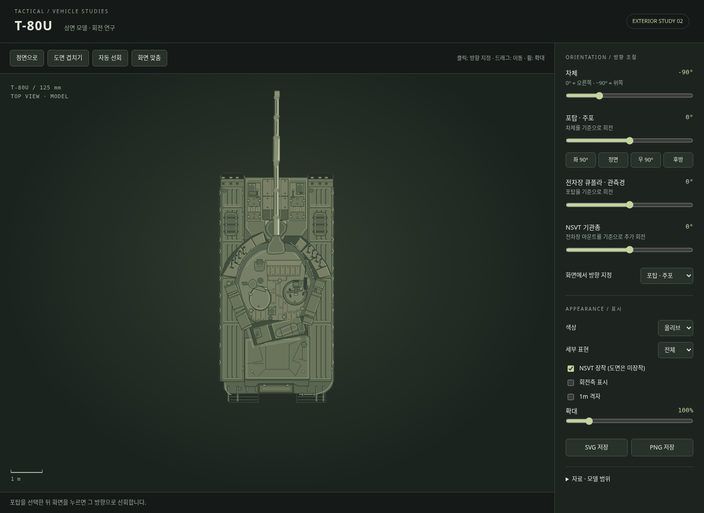

# T-80U 상면 모델 · 회전 미리보기

2026-11-14 수정 2판. [첫 모델의 형상 오류와 수정 대조](T80U_ART_CORRECTION.md).

2026-11-14, WIP20 main `450e900` 기반. 사용자가 요청한 모델링과 회전 범위의 독립 외형 모델이다.

[다운로드 ZIP](https://raw.githubusercontent.com/0-FLANDRE-0/Tactical_Project/refs/heads/main/T80U_TopView.zip) → 압축 해제 → `T80U_TopView.html`을 브라우저에서 연다. `T80U_ReferenceCheck.html`은 부위별 원본/모델 대조 화면이다. 두 HTML은 각각 단독으로 실행된다. 모델 미리보기에는 모델·조작 UI·비교 도면·사진이 포함되며 실행 중 외부 요청이 필요 없다. GitHub의 HTML 보기 화면은 실행 화면이 아니라 소스 보기다.



## 포함된 기능

- 차체, 포탑/주포, 전차장 큐폴라/TKN-4S 관측경, NSVT 기관총을 부모-자식 회전 레이어로 구성했다. 전차장은 관측장비를 뜻하며 승무원 인물 형상은 포함하지 않는다.
- `NSVT 장착`을 끄면 기관총과 추가 마운트를 감춘다. 도면 겹치기에서는 원본의 미장착 구성에 맞춰 자동으로 해제한다. 각 슬라이더는 부모 기준 상대각이다. 포탑을 돌리면 큐폴라와 기관총이 함께 이동하고, 큐폴라를 돌리면 그 위 기관총 마운트가 이동한다. 기관총 슬라이더는 마운트 기준 추가 회전이다.
- 화면 클릭으로 선택한 장비의 방향을 지정한다. 드래그로 이동, 휠/슬라이더로 확대, 자동 선회로 연속 회전을 확인할 수 있다. 회전 때 도형 DOM을 재생성하지 않고 변환만 갱신한다.
- `도면 겹치기`는 정렬된 정면 자세로 전환하고 같은 축척의 원본 도면과 겹친다. 불투명도를 0~100%로 조절할 수 있다. 회전하면 원본 도면의 정면 자세와 달라지는 것이 정상이다.
- 올리브·샌드·선화, 네 단계 세부 표현, 회전축 표시, 1m 격자, 투명 배경 SVG·PNG 저장을 지원한다. 저장 그림은 모델만 포함한다.
- 펜더와 스커트가 덮는 궤도는 위에서 노출하지 않는다. 차체·포탑 반응장갑, 둥근 주조 포탑, 해치, 관측경, 연막탄 발사기, 엔진 데크, 적재물, 포신 배연기 등을 분리했다.

## 자료와 정확도

기준은 [BTVT T-80U 설명 페이지](https://btvt.info/1inservice/t-80u.htm)의 [Object 219СБ1 치수 도면](https://btvt.info/1inservice/t-80u.files/sb1_1988b.jpg)이다. 2000×1003 원본을 보존했고, 하단 상면도를 추적했다. 측면도 7012mm 치수의 874px 길이에서 **양축에 동일한** `7.012 / 874 m/px`를 적용했다. 상면도 외곽 폭 450px는 약 3.610m로 정면도 외곽 폭 표기 3.628m와 약 18mm 차이가 난다. 스캔·서로 다른 투영도의 기준점 오차를 숨기기 위해 축별로 늘리지 않았다.

해치와 상부 장비는 [실차 사진 재게시물](https://andrei-bt.livejournal.com/1376413.html)도 대조했다. 사진의 Andrey Kryuchenko 워터마크와 게시물의 a_andreich 출처를 보존했다. 원출판·원도면 제작자·차량 연식·자료 재사용 라이선스는 확인되지 않았으며 공공영역 자료라고 표기하지 않는다. 사진의 원근과 장비 상태를 도면 치수로 취급하지 않는다.

벡터는 자료를 해석해 새로 작성한 **외형 근사**다. 특히 주포에 가려진 차체 전면 장갑판의 좁은 이음선, 포탑 회전축, 큐폴라/기관총 마운트 중심, 회전 시 드러나는 가려진 중앙 데크와 미세 부품은 실측이 아니다. 장비간 간섭, 기관총/큐폴라 실기구 연동·회전 제한, 고저각은 재현하지 않는다. UI 회전 속도도 시연값이다. 프로젝트 아카이브의 1985/1989 게임 방호력 차이를 역사적 외형 차이로 적용하지 않았다.

원본 해시·크롭·축척·기준점은 [proportion_review.json](../data/vehicles/references/t80u/proportion_review.json)에 기록했다. 이 모델은 게임의 차량 프로파일·장갑·충돌·관측점 기준이 아니다. 차량 등록, 전투·AI·LOS·이동 물리·탄약·피해는 기존 WIP20 그대로다.

## 소스와 재생성

- `src/art/t80u-topview.js`: 브라우저/CommonJS 겸용 벡터 모델. SVG와 Canvas가 같은 경로·레이어·회전축을 사용한다.
- `src/art/t80u-lab.html`: 조작 화면 템플릿.
- `data/vehicles/T80U_top_view.svg`: 정면 기본 SVG.
- `dist/qa/T80U_TopView.html`: 외부 의존성 없는 미리보기.
- `T80U_TopView.zip`: 고정 타임스탬프로 생성한 모델 미리보기 + 부위별 대조 화면 ZIP.

```sh
node scripts/build_t80u_art.cjs
node --test tests/t80u-art.test.cjs tests/vehicle.test.cjs
node scripts/verify_t80u_art.cjs
node scripts/verify_t80u_reference.cjs
```

재생성은 네트워크를 사용하지 않는다. 브라우저 검증은 Playwright와 Chromium을 사용하며 `CHROMIUM_PATH`와 `T80U_REVIEW_DIR`로 실행 파일·증거 출력 위치를 지정할 수 있다.

API: `T80UTopView.toSVG(pose)`, `svgBody(pose)`, `draw(ctx, pose, {x, y, pixelsPerMetre})`, `landmarks(pose)`. `pose`의 `heading / turret / commander / mg`는 도 단위, `lod`는 0~3, `palette`는 `olive / sand / line`이다. 좌표는 +X 전방, +Y 차량 오른쪽이며 회전각은 시계방향이다. 게임의 기존 월드 절대각/라디안 API에 직접 혼용하지 않는다.

## 검증

- 순수 모델 검사 5건: 축척·방향, 각 회전축 고정, 자식 레이어 이동, 포구 90° 변환, 각도 경계·잘못된 입력.
- 실제 Chromium 검사 10건: 네 레이어 렌더링, 변환만 갱신, DOM 행렬과 월드 좌표 일치, 원본 도면 겹치기, 화면 방향 지정, 자동 선회 시작/정지, SVG/PNG 다운로드, Canvas/SVG 그림 일치, 390px 모바일, 예외/외부 요청 없음.
- 세 자세/세부 설정의 Canvas/SVG 가시 픽셀 평균 채널 차이는 0.004/255 미만이었다.
- 기존 차량 검사 9건 통과. 기존 게임 실행 HTML·ZIP·차량 프로파일은 수정하지 않았다.
- 정면, 도면 겹치기, 차체·포탑·전차장·기관총 복합 회전, 모바일 화면을 캡처해 육안 확인했다.

- 수정 2판은 원본에서 독립 표본한 주포 단면 10곳의 상·하 경계와 폭을 2px 이내로 확인했다. 이는 SVG/Canvas 간 동일성 검사와 별개다.
- 주포 아래 차체 전면 ERA 5개 지점의 채움과 포탑을 90° 돌린 장면을 확인했다. 원본에 가려진 내부 이음선은 추정이다.
