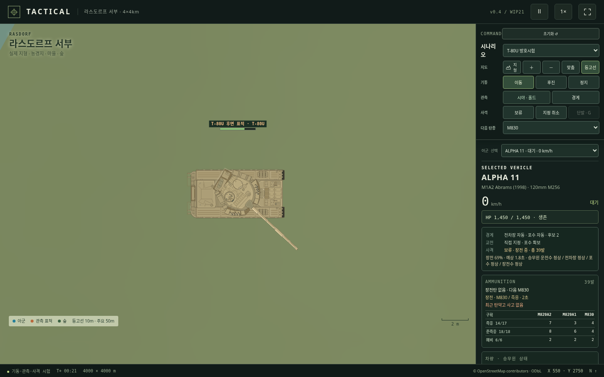
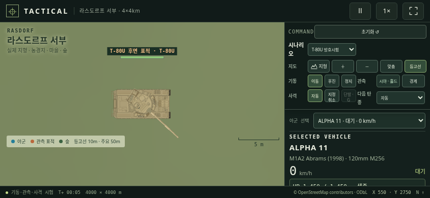

# WIP21 독립 병합 검토 — 2026-11-15 KST

검토 대상은 PR [#20](https://github.com/0-FLANDRE-0/Tactical_Project/pull/20), 구현 `730f336f03c6ab6815d17d8a8b9d680d1581a603`, 기준 main `be32d23ad4b95bc34aca95c793b0e3bbe7b81717`이다. **게임 기능의 병합 차단 문제를 발견하지 못했다.** 아래 캡처 검증 보완과 이 기록을 포함해 main으로 통합한다.

## 확인한 결과

- T80U_1989는 1,400 HP와 독립 7구역 KE/CE·고정 Kontakt-5를 소유한다. 기동·관측·사격·AI가 비활성이며 M1A2 탄약·장전수/피로·부상·장비·탄약고 사고 상태를 만들지 않는다.
- 명중·도탄 이후 피복 성공 시에만 K5가 한 번 가산된다. 후면 0%와 상부 45%를 구분하며 반복 피격에도 피복률/도안이 소모되지 않는다. 결과/사건 난수는 결정적이고 중복 착탄을 재적용하지 않는다.
- 수정 모델을 게임 어댑터가 부모 상대각으로 변환한다. 실제 배포 HTML에서 세 표적을 각각 32px/m로 확대해 차체·포탑 자세와 새 외형을 확인했다. 실제 지도 Canvas의 표적 그림과 동일 자세의 단독 모델을 불투명 픽셀 25,000개 이상씩 대조했으며, 세 자세의 평균 RGB 채널 차이는 각각 0.000053/0.000040/0.000066(0~255)이었다.
- 실제 3종 탄 발사·착탄·피해·표준 격파와 한 번의 T-80U 잔해 생성, 기억의 마지막 자세 고정과 잔해의 통행 차단을 확인했다. 기본 전투와 방호시험 사이 전환/reset은 접촉·탄·효과·HP를 새로 생성한다.

## 재검증

| 검사 | 독립 실행 결과 |
|---|---|
| 비브라우저 Node 전체 | 360/360 통과 |
| 실제 Chromium 기본 앱 및 WIP12~21 | 77/77 통과. 캡처 보완 뒤 WIP21 브라우저 경로 추가 재실행 통과 |
| Python 지형/DEM/자료 품질 | 7 + 4 + 7 = 18건 통과 |
| 추가 장갑 행렬 | 7구역·좌우 측면·3탄종·3거리·5각도·피복 경계의 1,620개 조합에서 기본/K5 방호와 관통 비교 일치 |
| 기존 피해 판정 비교 | 같은 1,620개 입력에 대해 기준 main의 M1A2 결과 전 필드와 일치 |
| 기본 전투 90초 비교 | seed 7, 1,800개 고정 틱 뒤 차량 위치·방위·포탑/전차장·HP·재고·구동 상태와 관측 통계가 기준 main과 일치 |
| ERA 반복 | 같은 표적에 1,000개 독립 사건 적용 후 피복 데이터 불변, 장전/승무원 반응 상태 없음. 해당 seed에서 피복 성공 880회 |
| 독립 LOS | 최적화 비교 worker가 별도 프로세스에서 현재 소스로 정상 실행 |
| 내보내기·빌드·ZIP | 재생성 전후 기존 제출 바이트 동일, 두 HTML 동일, ZIP 단일 항목·CRC·해제 바이트·SHA-256 확인 |

수치 검사는 주어진 게임 규칙과의 일치 확인이며 실제 차량 방호 성능 검증이 아니다. 원본 아트 정렬/근사 범위는 기존 [모델 설명](../T80U_ART_STUDY.md)과 [수정 기록](../T80U_ART_CORRECTION.md)을 따른다.

## 검토 중 보완

제출된 WIP21 데스크톱/모바일 캡처는 고정 좌표 `(850,2700)`를 확대해 실제 T-80U가 화면 밖에 있었다. 해당 이미지는 모델 연결의 시각 증거로 충분하지 않았다. `tests/wip21-browser.test.cjs`가 **현재 식별된 T-80U 접촉의 좌표로 카메라를 맞추고 화면 안에 있는지 검사**한 뒤 캡처하도록 보완했다. 모바일은 식별할 시간을 확보하고 16px/m, 데스크톱은 32px/m로 캡처한다. 기존 3종 탄·명령 경계·격파·초기화 검사는 유지하고 다시 통과했다. 게임 소스와 배포물의 바이트는 이 보완으로 바뀌지 않았다.

## 배포물과 한계

- HTML `Tactical_v0.4_WIP21.html` / `dist/index.html`: 8,537,604 bytes, SHA-256 `f3c6ac7bb4fe1cae516d1784f86cdfdd9308463f2b16046b89c1c2b60afa005b`.
- ZIP `Tactical_v0.4_WIP21.zip`: 1,692,841 bytes, SHA-256 `234ac77ac92e80857e85ce7f69d25d7dc4d3ce43887d72874a9b87b65aefc733`.
- 이번 T-80U는 정지 피격시험 차량이다. 125mm 발사·자동장전·기동·AI·차량별 센서·승무원/장비/탄약고 피해는 다음 범위이며, ERA 블록 폭발·소모·탈락도 없다.
- 실제 휴대폰 장시간 성능 검사는 하지 않았다. 지형/길찾기 원본은 바뀌지 않았으며 기본 전투 회귀와 작성자 성능 기록을 구분했다.

작성자 릴리스 기록은 [TACTICAL_RELEASE_WIP21.md](../../TACTICAL_RELEASE_WIP21.md), 구현 설명은 [T80U_MODEL_AND_ARMOR_WIP21.md](../T80U_MODEL_AND_ARMOR_WIP21.md)다. 이 독립 검토의 로그·별도 재현 스크립트·픽셀 대조·추가 행렬/기존 코어 비교·재빌드 해시는 검토 환경의 `/workspace/artifacts/wip21-review-730f336-2026-11-15/`에 보존했다.
