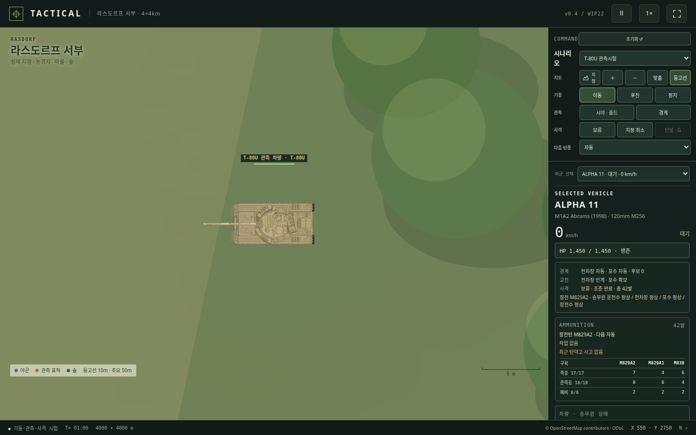

# WIP22 독립 병합 검토 — 2026-11-15 KST

검토 대상은 PR [#21](https://github.com/0-FLANDRE-0/Tactical_Project/pull/21), 구현 `2363c92ab1ac1ae2e16e9947f4732be26f672bc4`, 기준 main `04b937d99ede7e840b53559ee5a249551bc407de`다. **격파 순간 큐폴라 방위가 바뀌는 오류를 수정한 뒤 전체 재검증을 통과했다.** 수정과 아래 증거를 포함해 main으로 통합한다.

## 발견·수정한 문제

실제 관측시험에서 전차장·포수 확보를 기다린 뒤 M1A2의 정상 발사/비행/착탄으로 T-80U를 격파하면, 잔해의 큐폴라가 포탑 방위로 순간 이동했다. seed 7, HP만 1로 낮춘 재현에서 3발 발사 후 72.50초에 실제 큐폴라는 약 20.4°였지만 잔해는 -180°가 되어 최단 각도 약 159.6° 차이가 났다.

원인은 `src/sim-core.js`의 발사선/착탄용 `pose`에서 `commander`가 빠졌기 때문이다. 관측 격파의 즉시 잔해 생성은 누락 시 `turret`로 대체하고 이후 고정해 버렸다. 두 자세 생성 경로에 독립 전차장 방위를 포함했다. 장갑 판정·선회율·난수·무장 성능은 바꾸지 않았다.

`tests/wip22-t80u-observation.test.cjs`에 **실제 사격으로 격파된 잔해가 마지막 전차장/포탑 방위를 각각 보존하는 회귀 검사**를 추가했다. 수정 후 같은 재현의 방위 오차는 0이며 추가 5초 동안 두 축이 고정된다. 합성 체력 설정과 정상 사격 경로를 구분했다.

탐색 전 데스크톱 캡처도 아군이 T-80U를 식별한 뒤 확대하도록 보완했다. 적 자체 발견 전인 약 10초와 포수 확보 뒤 약 60초의 실제 게임 모델을 같은 축척으로 비교할 수 있다. 이전 첫 캡처는 초기 전체 지도여서 도안 확인에 불충분했다.

## 독립 재검증

| 검사 | 결과 |
|---|---|
| 제출본 전체 Node/Chromium 스크립트 | 378/378 통과했지만 위 오류는 추가 검사로 발견 |
| 수정 후 전체 `node --test --test-concurrency=2 tests/*.test.cjs` | **379/379 통과**, 실제 Chromium 스크립트 포함 |
| WIP22 전용 코어 | **9/9 통과**, 실제 격파 자세 회귀 포함 |
| Python 지형/DEM/원본 자료 품질 | **7 + 4 + 7 = 18건 통과**. 작성자가 쓰던 기본 Python과 달리 이 검토 환경의 `/usr/bin/python3`에는 GDAL이 있음 |
| 기존/신규 기본·방호시험 | 각 90초 실행 후 위치·차체/포탑/전차장·HP·구동/사격 상태와 관측 통계가 WIP21 기준과 일치 |
| 숨은 표적 위치를 달리한 대조 | 최초 미관측/확보 후 상실 두 경우 각각 45초, 합계 1,800개 스텝에서 T-80U 포탑/큐폴라 방위가 두 실행 사이 일치 |
| 인계 자격 중단 | 대기 중 관측 상실 시 후보 삭제, 재관측 자격 시작 0.60초 → 지정 1.10초. 중단 전 대기를 이어 쓰지 않음 |
| 정상 관측 흐름 | seed 7에서 40.45초 전차장 탐지 → 46.95초 식별 → 47.50초 인계 → 53.90초 포수 자체 확보 |
| 독립 LOS worker | 최적화 비교를 별도 프로세스에서 정상 실행 |
| 반복 내보내기/빌드/패키지 | 수정본 바이트 재현, 두 HTML 동일, ZIP 단일 항목·CRC·해제 바이트·체크섬 검증 |

기존 전체 검사와 별도로 검토한 사항은 24/40°/s 추적 상한, 8/12°/s 탐색 상한, 관측 전용 능력/시나리오 마스크, 근거리 실루엣과 식별 구분, 포수 자체 확보·기억 방위 고정, 일시정지, 실제 브라우저의 시나리오 전환/reset와 모바일이다. 적 내부 센서/인계 상태는 정상 아군 UI에 추가하지 않았다.

## 실제 게임 화면

두 화면은 **아군의 현재 식별 접촉**을 확대했다. 적의 시야·인계 내부를 UI에 표시하거나 적을 강제로 공개하지 않았다.

## 수정 후 배포물과 한계

- HTML `Tactical_v0.4_WIP22.html` / `dist/index.html`: 8,543,144 bytes, SHA-256 `0144dc7c1e053b87fc628b06202a16c27e5592b722e89309132122f91ea6b62f`.
- ZIP `Tactical_v0.4_WIP22.zip`: 1,694,704 bytes, SHA-256 `24cb087b4005f7dc5f7361fe994a08396c12001d78b6a6ac3e6e91951a4ff5b3`.
- T-80U는 정지 관측·추적 차량이며 발사·기동·자동장전·교전 AI는 후속 범위다. 기존 장갑·HP·ERA 비소모 규칙은 유지한다.
- 24/40°/s는 2차 자료 채택값이며 나머지 관측 수치는 게임 시험값이다. 실차/원 교범 및 실제 휴대폰 지속 성능은 검증하지 않았다. 작성자 성능 측정은 제출 커밋 기준이며 수정 후 기본/방호시험의 상태·관측 비용 경로는 별도 대조했다.

[릴리스 문서](../../TACTICAL_RELEASE_WIP22.md)와 [검증 JSON](../../tests/releases/WIP22-validation.json)을 수정 후 실행물에 맞춰 갱신했다. 독립 로그·재현 스크립트·수정 전/후 자세·숨은 위치 대조와 빌드 해시는 검토 환경의 `/workspace/artifacts/wip22-review-2363c92-2026-11-15/`에 보존했다.
